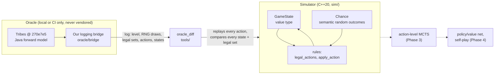
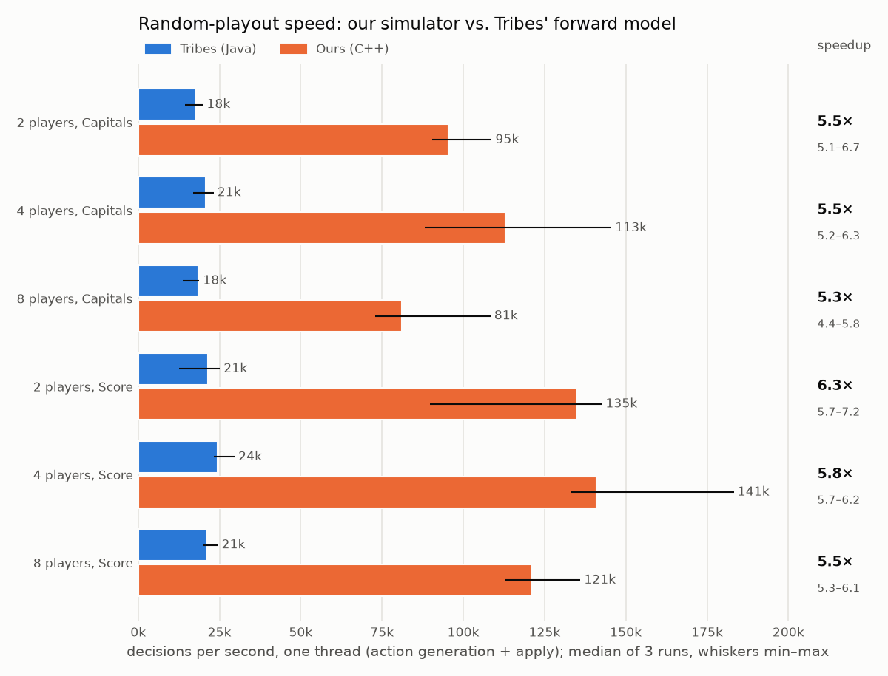
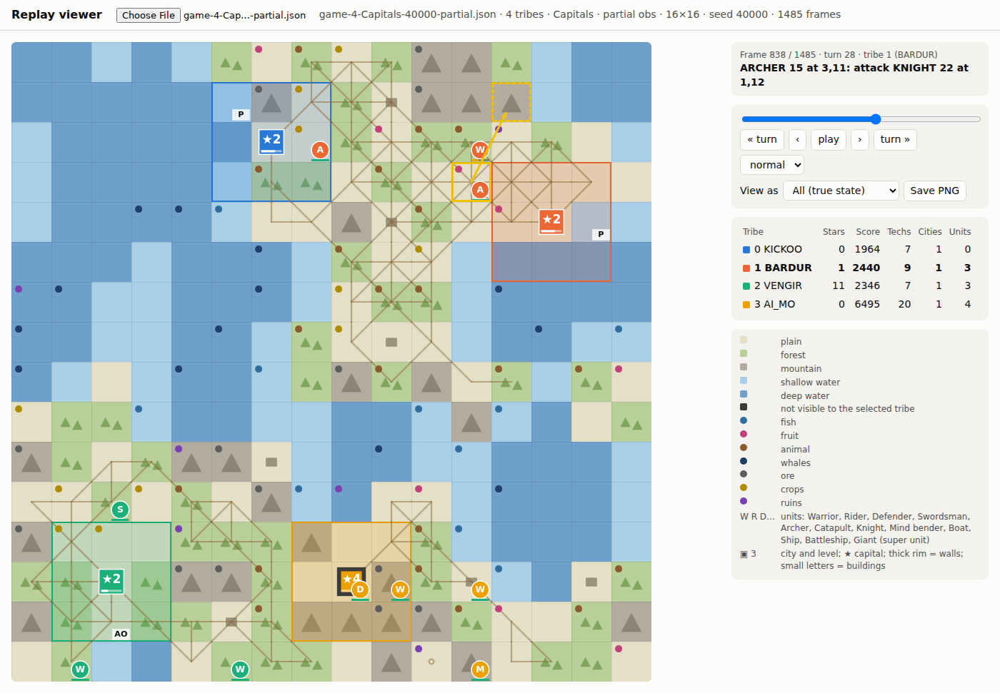
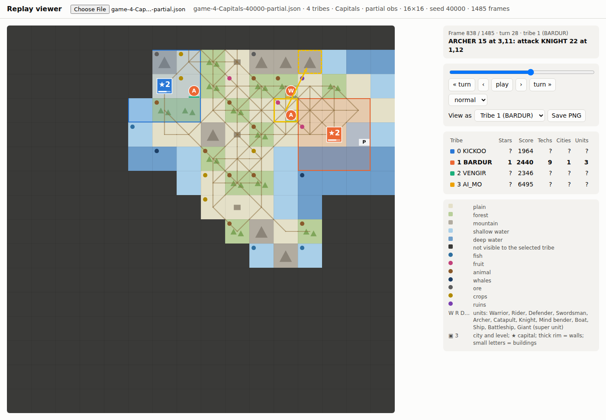

# Polytopia Engine: a Bit-Exact Strategy-Game Simulator, Built to Train an AI

An AI for *The Battle of Polytopia*-style turn-based 4X strategy, aiming to **beat a competent human**, a bar
the published research agents haven't cleared: in the Tribes paper (AIIDE 2020) the best agent, RHEA, lost
every game to a moderately skilled player. The plan is a fast C++20 simulator, action-level Monte Carlo tree
search, and a policy/value network trained by self-play.

**Phase 1, the simulator, is under way, and its rules are verified against the reference.** Every rule is
written from a facts-only rule sheet, then checked by replaying games logged from
[Tribes](https://github.com/GAIGResearch/Tribes), the research framework's Java forward model, action by
action, with and without fog of war. In **2,200 whole games, every one of 4,549,364 game states and every one of
4,159,721 legal-action sets matches the oracle exactly**, covering every action type Tribes has, and so does what each agent is allowed to see under fog. Search and learning come next; until they
exist, every row below that needs them is a dash.

Every number here links to the lab notebook or decision record where it was measured, with the command that
reproduces it. Dashes mean not measured yet.

*Hero GIF (the agent beating RHEA, search visit counts on the map): Phase 3.*

## At a glance

| | |
|---|---|
| **Game and rules source** | The Polytopia rules as implemented by Tribes (commit `270e7e5`): 12 tribes, 24 techs, 12 unit types, 19 buildings, ruins, diplomacy, Capitals and Score modes. Reimplemented from a written [rule-facts sheet](docs/rules/); Tribes has no licence, so none of its code is used ([ADR-002](docs/adr/002-rules-source.md)) |
| **Differential test** | Zero mismatches, in both observability modes ([2026-11-06](docs/notebook/2026-11-06.md), [2026-11-07](docs/notebook/2026-11-07.md)). **Map load: 700/700** initial states each with and without fog (2–8 players, all 12 tribes, both game modes). **Full observability:** 1,000/1,000 games (2,173,391 states, 1,992,166 legal-action sets) and 100/100 Mind Bender scenario games (71,560 / 59,253). **Fog of war:** 1,000/1,000 games (2,232,082 / 2,048,235; the first 140 included 800 random tech draws on meeting a tribe) and 100/100 Mind Bender games (72,331 / 60,067) |
| **Simulator speed vs. Tribes** | **5.3–6.3× faster** than Tribes' Java forward model on random playouts of the same levels (median of 3 runs per config, per-run range 4.4–7.2×): 81k–141k vs. 18k–24k decisions/s, one thread, 2–8 players ([chart and method](docs/media/2026-11-08-sim-speed.md); i9-11950H, WSL2) |
| **State** | One trivially copyable value type, **32.7 KB**, ~1.1 µs per copy (i9-11950H, WSL2, g++ 15 -O3; [ADR-005](docs/adr/005-state-encoding.md)) |
| **Search method** | — (action-level MCTS with macro-actions, Phase 3) |
| **Win rate vs. RHEA** | — |
| **Win rate vs. all Tribes agents** | — |
| **Network and training compute** | — (Phase 4) |
| **Human results** | — (Phase 5) |
| **Tests** | 50 GoogleTest unit tests, Release and Debug with ASan/UBSan; every difftest also run under the sanitizers on a subset |
| **CI** | Build, unit tests, clang-tidy and sanitizers; a short replay difftest against Tribes, with and without fog, on every push |

## Status

| Phase | State |
|---|---|
| 1 — Simulator | **In progress**: rule-facts sheet done; map load, every action type and legal-action generation bit-exact, with and without fog. the agent's fog-filtered observation matches Tribes' at every decision. Speed benchmarked against Tribes (5–6× faster); replay viewer; action encoding for search and the policy head ([ADR-006](docs/adr/006-action-encoding.md)). All Phase 1 checklist items done |
| 2 — Search baselines | Not started |
| 3 — Action-level MCTS + heuristic priors | Not started |
| 4 — Learned policy/value network | Not started (needs GPU time) |
| 5 — Evaluation | Not started |
| 6 — Real game, private matches with consenting humans ([ADR-003](docs/adr/003-real-game-phase.md)) | Not started |

Full scope and each phase's definition of done: [docs/buildplan.md](docs/buildplan.md). Current work:
[progress.md](progress.md).

## Architecture

Dashed: not built yet.

## Testing

**The simulator is the golden model, so it is tested against Tribes before anything is built on it.**

- **Rule-facts sheet first.** Tribes has no licence, so its code can't be ported. Instead every rule was read
  out of Tribes into our own words, with its quirks marked, in [docs/rules/](docs/rules/) (constants, combat and
  movement, cities and economy, capture/ruins/roads, turns/diplomacy/game end, map generation). The C++ is written
  from the sheet.
- **Differential replay.** A small Java bridge (ours) drives Tribes with every seed fixed and logs everything:
  the level, each draw on the game RNG and who drew it, the legal-action set before each decision, the action
  taken, the full state after it, and the filtered copy the agent was given. `oracle_diff` loads the level, replays each action, feeds Tribes' logged
  random outcomes back in through the `Chance` interface, and compares **every state field, every legal-action
  set and every agent observation**. A random draw requested for a different reason or range fails the game at that point.
- **Targeted scenarios** for rules normal games never reach. Heal others and Convert never occurred in 140
  normal games (one Mind Bender was spawned in all of them), so `make difftest-mindbender` starts every tribe with Philosophy and seats a small agent of ours
  that seeks those actions: 479 Converts and 226 Heals in 100 games, all matching.
- **Unit tests** for what the oracle corpus can't show: under full observability every tile is visible, so
  visibility checks are tested on hand-made states, as are rare paths (overlapping borders, uncapturable cities).
- **Tests are shown to fail.** Each change is checked by injecting realistic bugs (off-by-one ranges, wrong
  status transitions, skipped checks) and confirming a test catches each; the uncaught ones became new unit tests.
  The record is in the [lab notebook](docs/notebook/).

### Tribes quirks the difftest caught

Matching Tribes exactly means matching its bugs; each is recorded in the sheet as a **[Tribes quirk]**:

- A Rider that attacks and then moves ends **Finished**, not able to move again: the status transition is a chain
  of `if`s without `else`, so two transitions fire in one call ([02 §1](docs/rules/02-combat-movement.md)).
- A Battleship from ruins on water has **−1/−1 HP**, so any hit kills it
  ([03b §5](docs/rules/03b-capture-ruins-roads.md)).
- A city founded on a village inside another city's borders **can never be captured**: Capture looks up the
  tile's border owner ([03b §3](docs/rules/03b-capture-ruins-roads.md)).
- Philosophy gives an **80 %** research discount, not 20 % ([01](docs/rules/01-constants.md)).
- Under fog, two of a tribe's ports are linked only if a search **from the earlier port to the later one**
  succeeds; the reverse never counts, so a port hidden from its own tribe can't receive a link
  ([03a §6](docs/rules/03a-cities-economy.md)). Found by the fog difftest after 139 of 140 games matched.

## Simulator

- **State as a value** ([ADR-005](docs/adr/005-state-encoding.md)): fixed-capacity pools and inline vectors, no
  heap, trivially copyable, so search can copy it with `memcpy`. Actors keep Tribes' actor ids for logs.
- **Randomness as semantic outcomes.** Rules never draw raw numbers; they ask a `Chance` for "a ruin bonus",
  "a shuffle of these cities". Self-play samples them from one seeded RNG; the difftest replays Tribes' draws.
  Same seed, same game.
- **Legal actions in Tribes' generation order**, one shared legality predicate per action used by both
  generation and execution; an illegal action aborts loudly.
- **Every action has a fixed policy index** ([ADR-006](docs/adr/006-action-encoding.md)): its tile in a 24 × 24
  frame times 332 channels (type plus target offset or parameter), plus 130 global actions, 191,362 in all.
  Computed from the agent's observation and keyed by tiles rather than unit ids, so search can share statistics
  across sampled hidden states and the network prices every legal action in one pass. The move window (±7 tiles)
  follows from the movement rules; 155M legal actions on 1,200 generated maps encode without a collision.
- **Move generation replicates Tribes' search exactly**, including its priority-queue tie-breaking, because the
  reachable set depends on expansion order ([02 §3](docs/rules/02-combat-movement.md)).

## Results

Phase 1 results so far are the difftest and speed rows above.

**Replay viewer** (`make replay`, [details](docs/media/2026-11-08-replay-viewer.md)): a recorded 4-tribe game with
fog of war, random players; left the true state, right the same moment as the tribe to move sees it.

 
 Win rates will be reported with game counts and 95 % Wilson
confidence intervals, agent versions, seeds and hardware; engine changes will be accepted by SPRT.

## Limitations

- **The rules are Tribes' subset, not the current commercial game**: Tribes models a 2020 version with
  simplifications and its own quirks (above), and some content the real game has is absent. Phase 6
  ([ADR-003](docs/adr/003-real-game-phase.md)) addresses the real game.
- **The fog oracle is a one-line build change.** The pinned Tribes commit plays with full observability; the fog
  path is checked against a local build with only that constant flipped
  ([ADR-004](docs/adr/004-difftest-observability.md)), a configuration Tribes doesn't use by default. Where it
  behaves oddly we still match it, and record the quirk.
- **Observations mirror Tribes' quirks.** An agent's view is Tribes' own agent copy, field for field, including
  its oddities (every city's score value shows as 0; [04 §7](docs/rules/04-turns-diplomacy-end.md)). Legal actions
  can't be derived from it (6% of fog decisions differ), so agents get them from the game, as in Tribes.
- **Tribes' search agents are not reproducible run to run** (an unseeded RNG inside `GameState.copy()`), so games
  against them are reproducible only statistically. Difftests replay logged actions and are unaffected.
- **Speed numbers are noisy and unoptimised.** Absolute rates moved by up to ±50% between runs on the WSL2 laptop
  used, so the chart shows medians and ranges; nothing has been profiled or tuned yet, and fog games aren't timed.

## Prior work

- [**Tribes**](https://github.com/GAIGResearch/Tribes) (Perez-Liebana et al., *Tribes: A New Turn-Based Strategy
  Game for AI Research*, AIIDE 2020): the open research reimplementation used here as the rules oracle and as
  baseline opponents (Random, Rule Based, OSLA, MC, MCTS, RHEA).
- **Polyfish** (Rust): an AlphaZero-style engine with Gumbel self-play; a comparable engine.
- **polyterra-env**: an RL environment on decompiled game logic; not used, since that logic remains Midjiwan's.

## Credits and licence notes

- *The Battle of Polytopia* is by **Midjiwan AB**. This is a non-commercial research project, not affiliated with
  or endorsed by Midjiwan. It contains no Midjiwan assets, art, decompiled code or extracted game data
  ([ADR-003](docs/adr/003-real-game-phase.md)). No bot is ever connected to the game's online multiplayer.
- **Tribes** (QMUL Game AI Research Group) has no licence. It is therefore never copied, vendored or
  redistributed here: `make setup` clones it at a pinned commit for local (and CI) use as an oracle only, and the
  simulator is written from our own rule sheet ([ADR-002](docs/adr/002-rules-source.md)).
- This repository's own code and documents are under the [MIT licence](LICENSE). The licence covers only what is
  in this repository; it grants nothing over Tribes or *The Battle of Polytopia*.

## Build and reproduce

Requires a C++20 compiler, CMake ≥ 3.24 and Ninja (GoogleTest is fetched by CMake), Java 17 for the oracle,
Python 3.11+, and clang-tidy for `make ci`.

| Target | Does |
|---|---|
| `make setup` | Clones Tribes at the pinned commit into `oracle/tribes/` (gitignored) and compiles it with our bridge, plus a fog-of-war build copy |
| `make build test` | Release and Debug+ASan/UBSan builds; all unit tests in both |
| `make ci` | `test` plus clang-tidy (warnings are errors) |
| `make difftest-init N=700` | Map-load difftest: N initial states, 2–8 players, all tribes, both modes |
| `OBS=partial` (any of the three difftests) | Run it against the fog-of-war oracle build instead ([ADR-004](docs/adr/004-difftest-observability.md)) |
| `make difftest N=140` | Whole-game replay difftest: every state, legal-action set and agent observation (~65 MB of log per game) |
| `make difftest-mindbender N=100` | The Mind Bender scenario (Heal others, Convert) |
| `make difftest-batched N=1000` | The same games as `make difftest N=1000`, generated, replayed and deleted 32 at a time (~40 min per mode, 16 threads) |
| `make oracle-equiv N=25` | Checks our logging driver plays exactly like stock Tribes (`Game.run`) |
| `make oracle-log` | One full oracle log (`LEVEL`, `SEED`, `MODE`, `PLAYERS`, `TRIBES`) |
| `make bench N=200` | Speed vs. Tribes: random playouts on the same levels, 2/4/8 players × both modes → `data/results/bench-*.{csv,md}` |
| `make plots` | Speed chart from every bench run in `data/results/` (median, min–max) |
| `make replay [OBS=partial]` | Records one random game (`REPLAY_PLAYERS`, `REPLAY_MODE`, `REPLAY_SEED`) to `build/replays/`; open `tools/viewer/index.html` and choose the file |
| `make tournament`, `make selfplay train` | Later phases; fail loudly until implemented |

## Repository layout

| Path | Contents |
|---|---|
| `sim/` | The simulator: state, map load, rules and action generation, movement, trade network, state dump |
| `tools/oracle_diff.cpp` | The replay difftest driver |
| `tools/bench.cpp`, `tools/record.cpp`, `tools/viewer/` | Speed benchmark, game recorder and the replay viewer (one HTML file) |
| `oracle/bridge/` | Our Java harness around Tribes: seeded runs, the logging driver, the Mind Bender scenario agent |
| `oracle/scripts/` | Corpus generation and the loop-equivalence check |
| `tests/sim/` | GoogleTest unit tests |
| `docs/rules/` | The rule-facts sheet (01–05) |
| `docs/adr/` | Decision records, rejected alternatives included |
| `docs/notebook/` | Lab notebook: every session, bugs as symptom → root cause → fix |
| `search/`, `selfplay/`, `nn/` | Phases 2–4 |

## Roadmap

- **Phase 2–3:** search baselines, then action-level MCTS with heuristic priors and macro-actions, until it beats
  RHEA, with confidence intervals.
- **Phase 4:** a policy/value network trained by self-play (GPU time to be budgeted first).
- **Phase 5–6:** evaluation against every Tribes agent and against humans, then the real game, in private
  matches with consenting players only.
